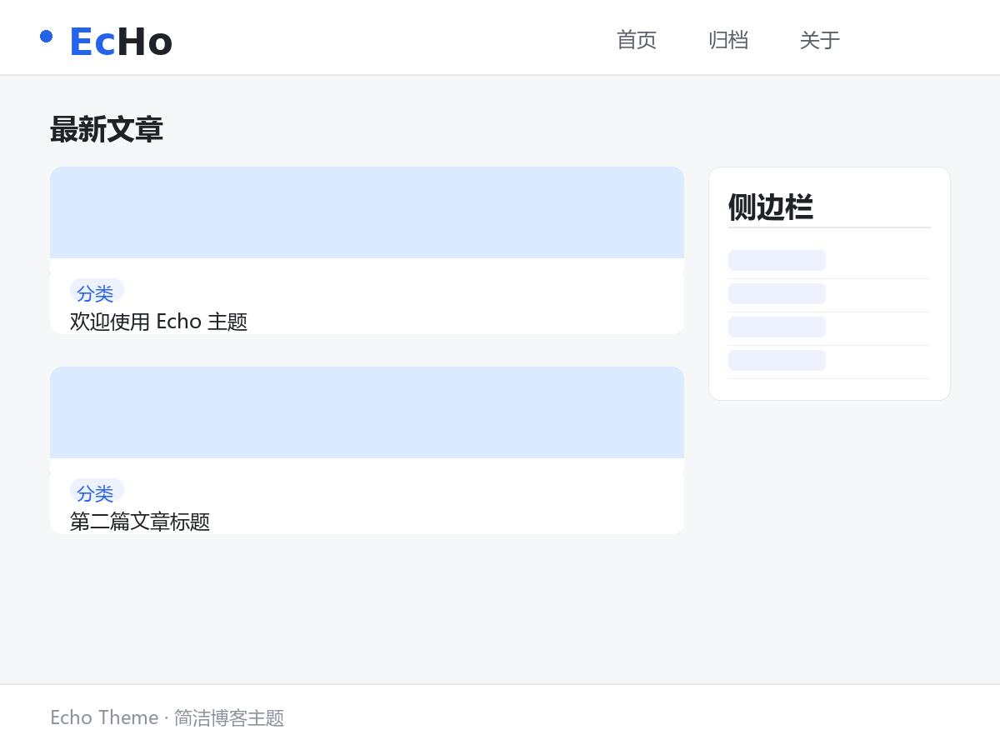

# Echo — WordPress 主题

Echo 是一款简洁、专注阅读体验的博客/论坛风格 WordPress 主题，响应式设计，适合个人博客与内容社区。

## 主题预览

> 顶部品牌区默认显示文字 Logo「**EcHo**」（`Ec` 为主题色高亮），可在「Echo 设置 → 站点标识」中修改内容或改用图片 Logo。

## 特性

- 响应式设计，桌面与移动端自适应
- 文章卡片式列表，支持特色图片
- 侧边栏小工具区域
- 内置搜索浮层
- 评论支持（含嵌套回复）
- 上一篇/下一篇导航
- 自定义 logo 与导航菜单
- **文字 Logo**：默认显示「EcHo」（`Ec` 主题色高亮），可在「站点标识」中开关、修改内容与强调部分
- 分页导航
- 404 页面
- **前台发文章**：登录用户无需进入后台，即可在 `/write` 页面撰写、编辑自己的文章，支持标题、可视化 / Markdown / HTML 三种正文输入、分类、标签、摘要与封面图
- **前台文章管理**：管理员（编辑/管理员角色）可在 `/write` 查看全站文章，直接发布、编辑、删除任意文章
- **外链跳转提醒**：全站外部链接统一经中转页提醒后再跳转，支持倒计时自动 / 手动点击两种模式
- **三栏个人主页**：`/uid/{用户ID}` 显示博客式三栏布局（资料导航 / 文章卡片流 / 归档分类），带深色模式开关，相关参数可在「Echo 设置 → 用户主页」配置
- **自定义主页导航**：每位用户可独立定制自己主页的左侧导航——显示/隐藏、拖拽排序、改名称与链接、选图标、添加自定义项；在个人主页（左栏「编辑导航」）、`/my` 个人中心，以及后台用户资料页（管理员可改他人）均可编辑。可在「Echo 设置 → 用户主页」关闭前台编辑
- **阅读互动**：文章阅读量统计（按访客去重防刷）、点赞、收藏（仅登录用户，每人每篇一次可取消）；文章页显示互动条、文章卡片显示阅读量；收藏汇总到个人中心「我的收藏」；提供「Echo 热门文章」侧栏小工具与 `[echo_hot_posts]` 短代码。相关开关可在「Echo 设置 → 阅读互动」配置
- 独立主题设置页（后台「Echo 设置」）：主题色、布局、页脚、前台发文章、外链中转页、阅读互动等

## 安装

1. 下载最新 Release 中的 `echo.zip`
2. WordPress 后台 → 外观 → 主题 → 上传主题 → 选择 zip → 立即安装
3. 启用 Echo
4. 在「设置 → 固定链接」保存一次（非「朴素」结构），使前台发文章路由生效

## 前台发文章

启用后，具备发文权限（`edit_posts`）的登录用户可访问 `/write/` 撰写文章，URL 中的 `write` 可在「Echo 设置 → 前台发文章 → 页面别名」中修改：

- **提交方式**：可选草稿 / 待审核 / 直接发布；「直接发布」仅对有发布权限的用户生效，其他用户自动降级为「提交审核」
- **我的文章**：页面底部列出当前用户的文章，可点击进入编辑
- **权限**：仅作者本人（或具 `edit_others_posts` 权限者）可编辑对应文章
- 导航栏与个人中心「写文章」入口会自动指向该页面

### 输入格式

正文支持三种输入模式，在编辑器右上角切换（可在「Echo 设置 → 前台发文章」中勾选可用模式与设置默认模式）：

- **可视化**：所见即所得的富文本编辑器（默认）
- **Markdown**：轻量语法（`#` 标题、`**加粗**`、`-` 列表、`>` 引用、围栏代码块等），可点「预览效果」查看渲染结果
- **HTML**：直接编写 HTML，危险标签与脚本会被自动过滤

三种模式正文统一存为安全 HTML；Markdown/HTML 原文会被保存，再次编辑时按原格式回填。

## 外链跳转提醒

启用后，全站正文、评论、友情链接等外部链接在点击时先进入 `/go/` 中转页，显示目标网站与完整网址提醒后再跳转。可在「Echo 设置 → 外链中转页」配置：

- **跳转方式**：倒计时自动跳转（默认 5 秒，可设 1–30 秒）或手动点击才跳转
- **提醒文案**：标题、说明、按钮文字均可自定义；可设置目标链接是否新窗口打开
- **白名单域名**：每行一个，支持 `*.example.com`，这些域名的链接不经过中转（本站始终跳过）
- **页面别名**：`go` 可在后台修改
- 目标地址保存在服务端临时数据、链接只含随机 token，防止开放重定向；仅允许 http/https 外链

## 主题设置

后台左侧菜单「Echo 设置」可自定义：

| 分组 | 设置项 |
|---|---|
| 颜色 | 主题色 |
| 布局 | 侧边栏位置、内容区最大宽度 |
| 页脚 | 版权文字、主题署名、副标题 |
| 前台发文章 | 启用开关、页面别名、可用提交方式、允许的分类/标签/封面、字数限制、导航入口 |
| 外链中转页 | 启用开关、页面别名、跳转方式、倒计时、提醒文案、新窗口、白名单域名 |
| 阅读互动 | 阅读量 / 点赞 / 收藏开关、阅读去重时长、热门文章条数 |
| 表情 | 总开关、正文/评论渲染、两处选择器按钮、显示尺寸 |
| 用户主页 | 启用开关、链接前缀、作者链接跳转主页（/author → /uid）、三栏个人主页、资料编辑权限、导航编辑 |
| 相关文章 | 显示开关、推荐数量、匹配方式（分类+标签/仅分类/仅标签）、缩略图、区块标题 |

## 表情

内置 111 个 MD3 风格 SVG 表情（纯矢量、无外部依赖）。在文章正文或评论中输入短代码如 `[.OK]`、`[.点赞]`、`[.笑哭]`，前台会自动渲染为与正文同高的表情图片；代码块内的短代码不会被渲染。写文章页正文区和评论框均提供表情选择器，点击按钮弹出面板，支持按名称搜索、点击插入到光标位置（兼容可视化 / Markdown / HTML 三种输入模式）。

在「Echo 设置 → 表情」可独立开关正文/评论渲染与两处选择器按钮，并设置表情显示尺寸（12–48 px）。全部资源随主题打包，无外链请求。

## 阅读互动

开启后可在「Echo 设置 → 阅读互动」独立开关阅读量、点赞与收藏，设置阅读去重时长（防刷新刷量）与热门文章展示条数。文章页显示互动条（点赞 / 收藏），列表卡片显示阅读数；另提供热门文章小工具与短代码，个人中心「我的收藏」可集中查看已收藏文章。

## 作者

[LogicTneXus](https://github.com/liutexi)

## 许可证

Apache License 2.0
